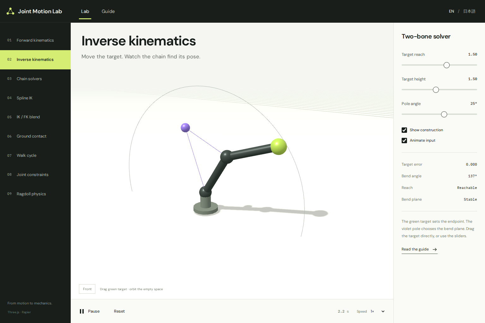
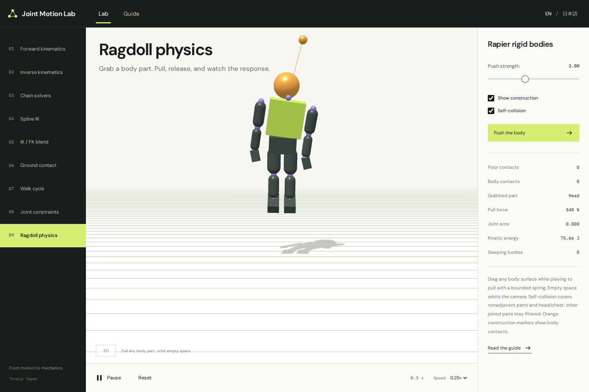
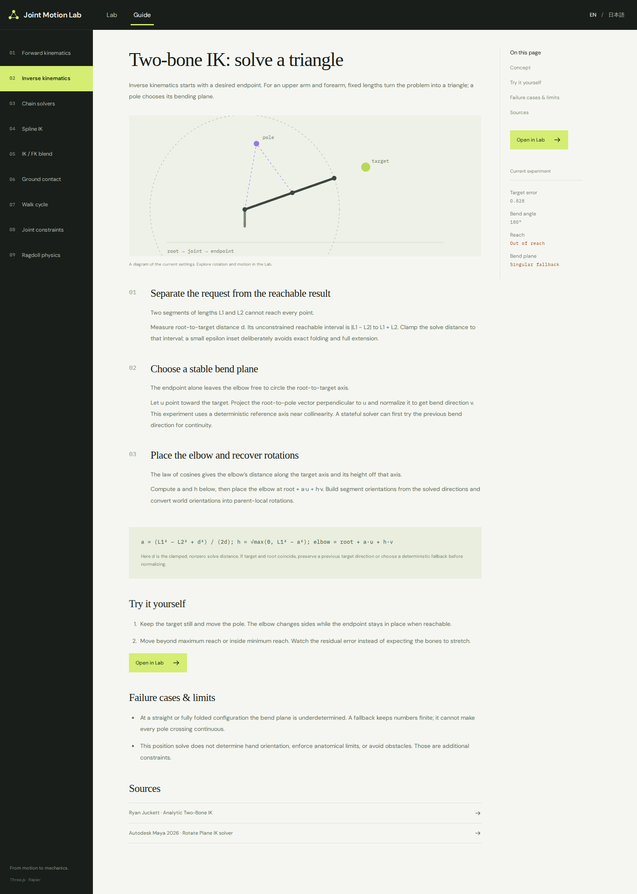

# Joint Motion Lab

An interactive, bilingual motion laboratory for joint-based animation. The primary screen is a real Three.js viewport; the separate Guide explains the mechanism, the experiment, and its limitations.

Turn a target, pole vector, curve, or joint limit and watch the motion respond. Compare geometric solvers with genuine rigid-body physics, then open the Guide to understand why they behave differently.

- Learn through nine focused, adjustable 3D experiments
- Pull the ragdoll by a hand, foot, head, or any visible body surface
- Switch the entire lab and technical guide between English and Japanese
- Run locally without accounts, API keys, or a backend



Actual Chromium/WebGL capture of the application, not a design mockup. [Screenshot provenance](docs/screenshots/README.md).

## Run locally

Requires Git, Node.js 22.12+ (Node 24 is used in CI), npm, and a browser with WebGL2 support.

```sh
git clone https://github.com/domizo/joint-motion-lab.git
cd joint-motion-lab
npm ci
npm run dev
```

Open the local URL printed by Vite, normally `http://localhost:5173`. To preview a production build:

```sh
npm run build
npm run preview
```

## Verify

```sh
npm run check      # strict TypeScript
npm test          # independent solver / scene / rigid-body tests
npm run build     # deployable static assets in dist/
npm run test:e2e   # actual WebGL browser tests, screenshots and traces
```

For the browser suite, first install its browser with `npx playwright install chromium`. CI installs the browser and Linux dependencies itself. The app works entirely client-side: no accounts, backend, analytics, remote model calls, character asset downloads, or API keys. Font files and Rapier's WebAssembly are bundled locally.

## Nine experiments

| Experiment        | Implementation                                                                                             |
| ----------------- | ---------------------------------------------------------------------------------------------------------- |
| FK                | Parent-local quaternion composition, inherited rotations and local-axis helpers                            |
| Two-bone IK       | Analytic triangle solve, pole plane, reach clamping and deterministic singular fallback                    |
| Chain solvers     | CCD and FABRIK from identical seeds, live error and iteration budget                                       |
| Spline IK         | Catmull–Rom curve, arc-length sampling, parallel-transport frames and distributed twist                    |
| IK/FK blend       | Local quaternion SLERP, FK evaluation and explicit pose matching in both directions                        |
| Hand contact      | Fixed world-space target, moving shoulder, lock toggle and reach error                                     |
| Walking           | Procedural stance/swing targets, planted world-space feet, leg IK and reach-aware pelvis height            |
| Joint constraints | Local swing/twist decomposition and angular clamping, requested/limited comparison                         |
| Ragdoll           | Genuine Rapier bodies, surface-point spring dragging, selective self-collision, joints and ground contacts |

The Guide contains original English/Japanese explanations, formulas, parameter experiments, failure cases, diagrams generated from the current settings (plus a labeled static ragdoll schematic), and primary-source links. The language switch changes both the lab and the guide. Every experiment has a direct URL, such as `?demo=spline&view=guide&lang=en`.

## Interaction

- Green IK target: drag directly, including touch; empty viewport: orbit; wheel/pinch: zoom
- Ragdoll: grab any visible body surface with mouse or one finger to pull through a bounded physical spring. The plane faces the camera at the original picked depth; orbit before grabbing to change depth direction. Pausing ends a pull and disables new grabs until Play
- Self-collision defaults on. Head/chest contact is enabled; other directly joined limb/spine pairs are filtered. Orange construction markers and Body contacts show actual body/body contacts separately from the floor
- Play/pause, reset, playback speed, construction visibility, per-experiment parameters
- Space toggles playback and R resets when focus is outside an interactive control
- Reduced-motion preference starts paused
- Hidden tabs, hidden lab views and offscreen viewports stop simulation advancement
- Lab/Guide navigation preserves parameters; selected sliders persist locally on reload
- Rapier loads only when the ragdoll is opened; physics uses a 1/120-second fixed step



A picked surface point drives a bounded spring. The body remains simulated by Rapier.



The Guide connects the visible motion to the mechanism, controls, and failure cases.

## Architecture

```text
src/content/demos.ts       chapter metadata, controls, bilingual interface copy
src/content/guide.ts       technical teaching copy and source links
src/engine/kinematics.ts   pure mathematical solvers
src/engine/frame.ts        procedural scene and gait composition
src/engine/ragdoll.ts      genuine rigid-body dynamics, independent of Three.js
src/engine/renderer.ts     Three.js meshes, camera, pointer handling and disposal
src/components/           viewport lifecycle, guide, metrics and icons
```

Three.js 0.180.0 and Rapier 0.19.3 are pinned by the lockfile. React/Vite provide the application shell. The physics chunk includes its WebAssembly and is deliberately larger than the initial application bundle.

## Scope and limitations

This is an educational first release, not a production character-rigging package. All geometry is procedural. There is no skinning, character importing, keyframe editor, animation export, retargeting, active physical balance, or full animation-to-ragdoll transition system.

The first eight experiments are kinematic or geometric. Hand and foot targets do not exert forces. Only the ragdoll is a dynamics simulation. The spline follows equal arc lengths but does not enforce exact bone/chord lengths. Matching positions and bend direction does not preserve arbitrary joint twist or end-effector orientation. The pole fallback is deterministic rather than history-stabilized. Ragdoll spherical joints are unrestricted; head/chest collision prevents the former sustained neck overlap, but this is not an anatomical neck-angle limit. The numerical contact/constraint solver can produce transient penetration or larger errors under strong impulses. One extreme-pull check reached 24.8 mm of transient head/chest overlap; ordinary-case millimeter measurements are not a universal bound. The pull is force-, extension-, and target-speed-limited, so the simulated anchor can lag the pointer.

See [primary references and scope](docs/REFERENCE_SOURCES.md) and [verification record](docs/VERIFICATION.md).

## License and dependencies

The application source and original documentation are available under the [MIT License](LICENSE), copyright 2026 domizo. Third-party packages, fonts, and bundled WebAssembly retain their own licenses. See [third-party notices](public/THIRD_PARTY_NOTICES.txt) and the [WASM notice inventory and provenance](docs/THIRD_PARTY_INVENTORY.md). `private: true` prevents accidental npm publication; it does not restrict the MIT license.

## 日本語

Joint Motion Lab は、ジョイントの仕組みを「動かして理解する」ための3D実験室です。目標位置やポールベクター、曲線、関節の角度制限を変え、その結果を見ながら、別画面のガイドで理由と計算方法を確認できます。

### できること

- FK、2ボーンIK、CCD/FABRIK、Spline IK、IK/FKブレンドとマッチング
- 手の接地、足を固定する歩行、ローカル座標のSwing/Twist制限
- Rapierによるラグドール物理、身体表面のドラッグ、選択的な自己衝突
- 実験と技術ガイドの日本語／英語切り替え

### 起動

Git、Node.js 22.12以上（CIはNode 24）、npm、WebGL2対応ブラウザが必要です。上の「Run locally」の4行でcloneして起動し、Viteが表示するローカルURLを開きます。アカウント、APIキー、サーバー側の設定は不要です。`npm run build` と `npm run preview` で本番ビルドも確認できます。

### 操作と範囲

緑のIK目標は直接ドラッグできます。ラグドールは再生中に身体の見えている箇所をマウスまたは1本指でつかみ、カメラに平行な平面上で引っ張れます。空白部分のドラッグはカメラ回転です。奥行き方向を変えたい場合は、つかむ前にカメラを回します。一時停止や画面移動でつかみ状態は解除されます。

自己衝突は初期状態でオンです。隣接しない部位と頭・胸の接触を計算し、それ以外の直接つながった四肢・背骨のペアは除外します。強い操作では一時的なめり込みがあり、強い引っ張りの検証では頭・胸の重なりが約24.8 mmに達した例もあります。すべての組み合わせで重なりを防ぐ保証や、人体に沿った首の角度制限はありません。

最初の8実験は幾何・運動学で、力を使う物理シミュレーションはラグドールです。学習向けのため、スキニング、キャラクター読込、キーフレーム編集、アニメーション書き出し、リターゲット、自律的なバランス制御は含みません。スクリーンショットは実際のアプリをChromium/WebGLで撮影したものです。

アプリ本体と独自ドキュメントは[MITライセンス](LICENSE)です。依存ライブラリ・フォント・WASMにはそれぞれのライセンスが適用されます。[検証範囲](docs/VERIFICATION.md)と[第三者ライセンスの収録範囲](docs/THIRD_PARTY_INVENTORY.md)も参照してください。
